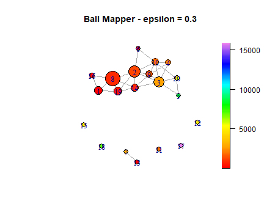
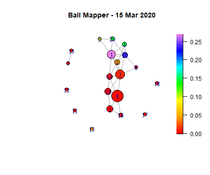
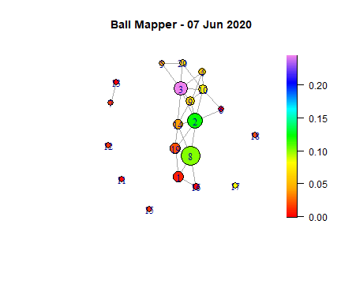

# Global COVID-19 and Topological Data Analysis Ball Mapper

Group project for MTH4322 at Queen's University Belfast (December 2025), done with Joshua Cunningham and Eoin McFerran. I wrote the R code and compared the ball sizes (epsilon). We chose the variables together.

**Question:** in the first three months of the pandemic (15 March to 15 June 2020), which countries look alike in terms of age, wealth, density, hospital capacity and travel restrictions, and how did their COVID-19 case counts differ?

## What Ball Mapper does

Each country is a point in five-dimensional space, with one coordinate for each variable (after standardising every variable to run from 0 to 1). Countries that are close together in this space have similar population density, age, wealth, hospital capacity and travel restrictions.

**How a ball is formed**

1. Pick a country that is not yet in any ball. It becomes the centre of a new ball.
2. Put into that ball every country within distance epsilon of the centre, measured as ordinary straight-line distance across the five scaled variables.
3. Repeat from step 1 until every country is in at least one ball.

A country can be in several balls, because balls are allowed to overlap. The balls are numbered in the order they were made.

**How the graph is drawn.** Each ball is one dot, and two dots are joined by a line when their balls share at least one country. Dots that are joined hold countries with similar profiles, and a dot with no lines is a country or group that is unlike the rest.

**What the colour means.** Each ball is coloured by the average of a chosen value over the countries inside it. In the main graph that value is cumulative cases per million. In the fortnightly graphs it is the share of all cases that day. Because the position of a ball depends only on the five variables, the colours show whether countries with similar profiles also had similar case counts.

**What epsilon does.** It sets how big the balls are. A small epsilon gives many small balls with few lines between them. A large epsilon gives a few large balls that hide the differences between countries. The report compares four sizes and picks 0.3.

## What the code does

1. Reads the two data files and keeps 15 March to 15 June 2020.
2. Takes five variables for each country: population density, median age, GDP per capita, hospital beds per thousand and the highest travel control level in the period (0 to 4). It also adds up daily new cases per million into a cumulative total.
3. Merges the two files and drops countries with missing values. 133 countries are left.
4. Scales each variable to run from 0 to 1 and builds the Ball Mapper graph with the `BallMapper` package, coloured by cumulative cases per million.
5. Compares epsilon = 0.2, 0.3, 0.4 and 0.5 and picks 0.3 (see below).
6. Draws a graph every 14 days, coloured by each ball's share of all cases that day.
7. Colours the epsilon = 0.3 graph by each of the five variables in turn, and plots the average cumulative cases of chosen balls over time.

## Results (from the report)

- **Choice of epsilon.** At 0.2 the graph breaks into many isolated balls. At 0.4 and 0.5 the balls merge into a few large ones and the structure is lost. At 0.3 the graph stays connected and still has separate groups.
- **Highest case counts.** Ball 5 (Iceland and Bahrain), ball 17 (United Arab Emirates and Qatar) and ball 18 (Singapore) have the highest average cumulative cases. These countries have high GDP per capita, high or moderate population density and few hospital beds per thousand.
- **A contrast.** Ball 13 (Japan and South Korea) looks similar on GDP and density but has many more hospital beds and far fewer cases. Ball 19 (for example Ghana and Iraq) has low density, lower income and low case counts.
- **Over time.** Early on only a few balls hold a large share of global cases. By late May and June the share is spread over many more balls.

| 15 March 2020 | 7 June 2020 |
|---|---|
|  |  |

## Things to keep in mind

- The graphs describe and compare. They do not show what causes differences in case counts.
- Reported cases depend on how much testing a country did, so they are not a clean measure of how many people were infected.
- Only 133 countries have complete data. Regions and many small countries are dropped because they are missing a variable.
- Each country's population density, age, GDP and beds are single values, and the travel variable is the highest level reached in the three months.
- Some balls hold only one or two countries, so their colour is the value for those countries, not an average of a group.

## Data

The data files are not in this repository. The COVID-19 file is about 150 MB, and both datasets have their own terms of use. Download them and put them in `data/` with these names:

| File in `data/` | Source |
|---|---|
| `world_covid_data.txt` | [Our World in Data, COVID-19 data](https://docs.owid.io/projects/etl/api/covid/#download-data) |
| `international-travel-covid.txt` | [International travel controls, Our World in Data](https://ourworldindata.org/grapher/international-travel-covid) (Blavatnik School of Government, University of Oxford, with minor processing by Our World in Data) |

The code expects dates written as day/month/year, as in the files we used. A fresh download may use another format, in which case change the two `as.Date(..., format = "%d/%m/%Y")` lines.

## Run

Open `covid_ball_mapper.Rmd` in RStudio and knit it, or run the chunks one by one. Packages: BallMapper, dplyr, tidyr, scales, igraph, ggplot2, purrr. The plots are also saved as PNG and PDF files in `figs/`.

## Reference

Dlotko P and Rudkin S (2020). Visualising the Evolution of English Covid-19 Cases with Topological Data Analysis Ball Mapper. The first half of our report summarises this paper and the second half applies the same method to the world data above.
