# Master's project: volunteer first responders and cardiac arrest in Northern Ireland

Master's project (MSci, Queen's University Belfast, 2026), supervised by Dr Karen Cairns. A Monte Carlo simulation in R. The dissertation also includes a separate discrete-event simulation of ambulance handover queues (R, simmer), with its script in [`des/`](des). The full dissertation is in [`report/`](report/MSci_dissertation_Andrew_Jones.pdf).

**Question:** would a scheme of volunteer first responders, paged to cardiac arrests and carrying defibrillators, be good value for the NHS in Northern Ireland, and where and how should the volunteers be placed?

**Short answer, as the model has it:** in Belfast the scheme costs about £26,500 per quality-adjusted life year (QALY), and about 70% of simulated five-year periods come in under NICE's £30,000 limit. In rural Fermanagh it costs about £161,800 per QALY, far above any threshold.

## Background

Survival after a cardiac arrest outside hospital falls by about 10% for every minute without a shock from a defibrillator. Rural ambulances take longest to arrive, so volunteers who live nearby and carry defibrillators could sometimes get there first. Cairns, Marshall and Kee (2011) simulated such a scheme in one rural part of Northern Ireland and found it unlikely to be good value.

Several inputs have changed since then, so this project reruns the idea with:

- the 2021 Census (3,780 Data Zones, population 1,903,066), which shows an older population
- the 2021 to 2023 Northern Ireland life tables
- newer long-term survival figures after cardiac arrest (Dillenbeck et al., 2024)
- NICE's higher range of £25,000 to £35,000 per QALY from April 2026. It applies to technology appraisals (mainly medicines), so £35,000 is used here as a possible future limit for a scheme like this
- all 26 districts instead of one rural area, and twelve ways of placing the volunteers

## How the model works

Each simulated year runs through these steps for every Data Zone ([flowchart](figures/01_model_flowchart.png)).

1. **Arrests.** Expected witnessed ventricular fibrillation arrests a year = people in each age and sex group × the yearly arrest probability for that group, added up. The yearly count is drawn from a Poisson distribution, which gives about 2,600 arrests a year across Northern Ireland. Each arrest gets an age group, sex, hour and week.
2. **Ambulance time.** A log-logistic accelerated failure time (AFT) model, fitted by Cairns et al. to 75,219 incidents, gives the journey time from the distance to the nearest and second-nearest station, whether the nearest is within 2 miles, and the time of day. Station distances are calculated here from a geocoded list of ambulance stations.
3. **Volunteers.** Volunteers (31 per district, or 806 across Northern Ireland, depending on the rule) are placed by one of twelve allocation rules, live at random points inside their Data Zones and are split into four weekly rotas, about 8 on duty in any week. For each arrest, volunteers within 15 miles are paged if dispatch recognises the arrest (40% of the time). Each then needs to have their kit (80%) and be free to go (30%, falling with distance). A second AFT model gives their journey time from distance and urban or rural area.
4. **Survival.** The first defibrillator to arrive, ambulance or volunteer, sets the time used in a logistic survival model (Valenzuela et al., 1997). The same random number decides survival with and without volunteers, so a volunteer can only help. The difference is the extra survivors.
5. **Long-term outcome.** Each extra survivor gets a neurological state (no or mild 81.3%, moderate 15.65%, severe 3.05%) with its own quality of life and care costs, and is followed year by year in a Markov microsimulation. Death rates come from the life tables, adjusted so that survivors with no or mild impairment match the 73.8% five-year survival reported by Dillenbeck et al. Costs and QALYs are discounted at 3% a year over a 40-year horizon.
6. **Cost-effectiveness.** Results are grouped into five-year periods to match the scheme's five-year cost (£474,256 for 31 volunteers in a district). For each period, cost per QALY (the ICER) = (scheme cost + care costs) ÷ extra QALYs. Repeating this over many simulated years gives the mean, a 95% range and the share of periods that are cost-effective at each threshold.

The model structure and most of its inputs follow Cairns et al. (2011): the two AFT models, the dispatch, kit and attendance probabilities, the survival model and the costs are published values. What this project adds is the implementation, the 2021 data, the life-table and Dillenbeck-based long-term model, the station distances, the extension to all 26 districts with twelve allocation rules, and the discrete-event simulation.

## Results

Volunteers placed within each district in proportion to expected arrests (rule A1), 1,000 simulated years per district. Ranges are the middle 95% of simulated years or five-year periods.

| | Belfast | Carrickfergus | Fermanagh |
|---|---|---|---|
| Mean time to arrival, ambulance only | 8.2 min | 10.5 min | 15.3 min |
| Mean time to first arrival, ambulance or volunteer | 7.7 min | 9.3 min | 14.4 min |
| Survival to discharge, ambulance only | 9.1% | 6.9% | 4.8% |
| Survival to discharge, with volunteers | 9.7% | 8.3% | 5.3% |
| Extra survivors a year | 2.6 (0.0 to 6.0) | 0.8 (0.0 to 3.0) | 0.5 (0.0 to 2.0) |
| Extra QALYs a year | 12.9 | 4.3 | 2.6 |
| Mean cost per QALY over five-year periods | £26,509 | £62,142 | £161,808 |
| 95% range of those periods | £18,998 to £37,637 | £21,776 to £220,560 | £26,191 to £817,373 |

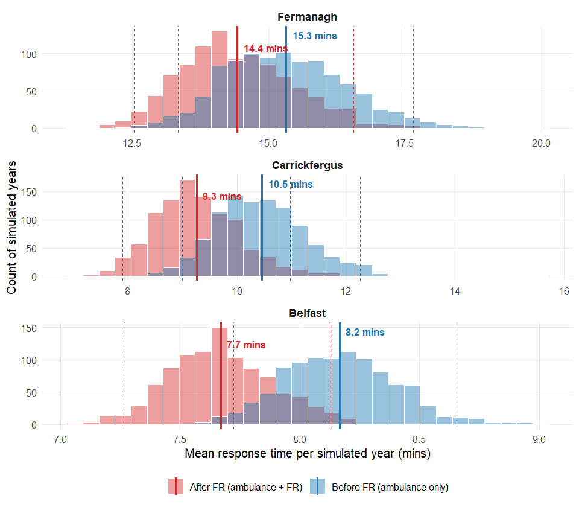

Most simulated years save nobody or one or two people, which is why the cost per QALY ranges so widely below. Share of arrests saved by the scheme in each simulated year:

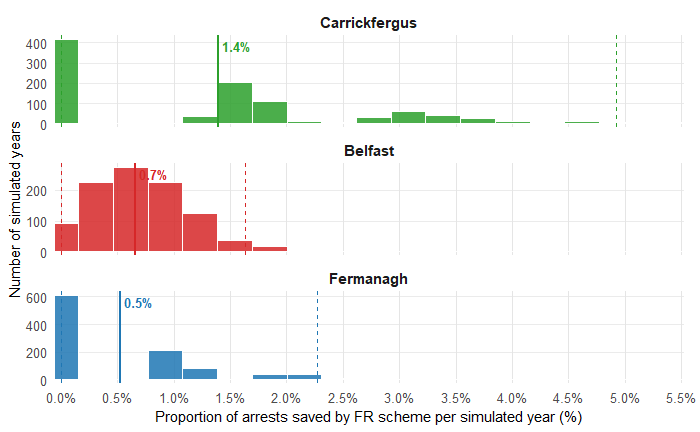

In Belfast about 70% of simulated five-year periods were cost-effective at £30,000 per QALY and about 80% at £35,000. Belfast comes out best even though Carrickfergus saves more time per arrest (1.2 minutes against 0.5), because Belfast has far more arrests to spread the same fixed scheme cost over.

<p>
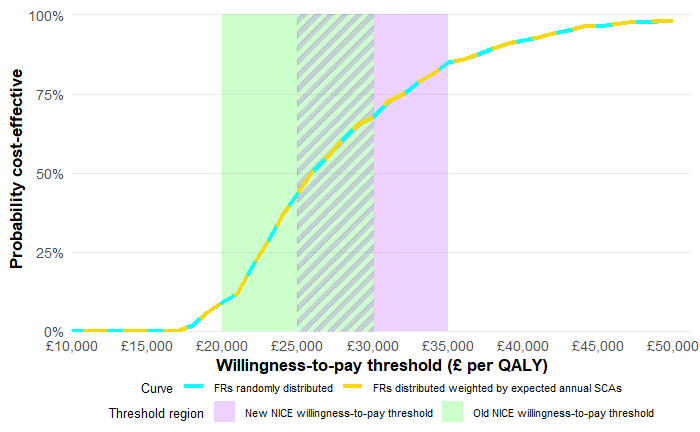
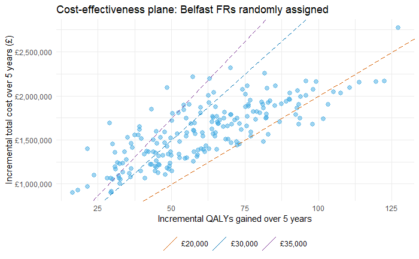
</p>

Cairns et al. (2011) reported £54,234 per QALY for a rural area that pooled Fermanagh, Cookstown, Dungannon and Omagh. Fermanagh alone is higher still. It is the most sparsely populated district, and with 0.5 extra survivors a year the ratio is very unstable, which is why its range runs from £26,191 to £817,373.

### Where to put the volunteers

Screening run: all twelve rules, all 26 districts added up, 20 simulated years per rule and district, with the scheme cost spread over its five years. These figures are indicative.

| Rule | Where the volunteers go | QALYs a year | Cost per QALY |
|---|---|---|---|
| A1 | Within each district, by expected arrests | 107.5 | £41,621 |
| A3 | Within each district, 80% arrests and 20% area | 96.6 | £42,240 |
| A6 | Within each district, at random | 102.1 | £42,374 |
| A2 | Within each district, 90% arrests and 10% area | 96.2 | £46,335 |
| A4 | Within each district, arrests × area^0.25 | 86.5 | £46,388 |
| A5 | Within each district, arrests × log(area) | 78.6 | £50,607 |
| B6 | Across Northern Ireland, at random | 137.0 | £35,712 |
| B1 | Across Northern Ireland, by expected arrests | 130.7 | £37,305 |
| B2 | Across Northern Ireland, 90% arrests and 10% area | 113.6 | £39,703 |
| B3 | Across Northern Ireland, 80% arrests and 20% area | 102.9 | £42,315 |
| B4 | Across Northern Ireland, arrests × area^0.25 | 88.8 | £46,297 |
| B5 | Across Northern Ireland, arrests × log(area) | 69.9 | £54,028 |

- Within districts, placing volunteers by expected arrests gave the most QALYs and the lowest cost per QALY.
- Adding weight for area, to favour large rural districts, made things worse under both families of rules.
- Placing volunteers by expected arrests across Northern Ireland (B1) gave more QALYs than 31 per district (A1) because it puts more of them in Belfast (72 instead of 31). That is the trade-off between efficiency and fairness to rural areas.
- Rule B6 comes out slightly ahead of B1, but its ambulance-only time (11.78 minutes) differs from the 10.95 in every other row, although that scenario is the same for all rules. So B6 was run on a different set of simulated arrests and is not strictly comparable.

### Sensitivity

One-way sensitivity analysis for Carrickfergus (proportion of arrests saved): the result moved most with the number of volunteers available per week and the probability that a paged volunteer attends, each by about 1.5 percentage points. Dispatch sensitivity came next, kit pick-up less, and the length of the rota hardly mattered. Effort is better spent on recruiting and placing volunteers than on the rota.

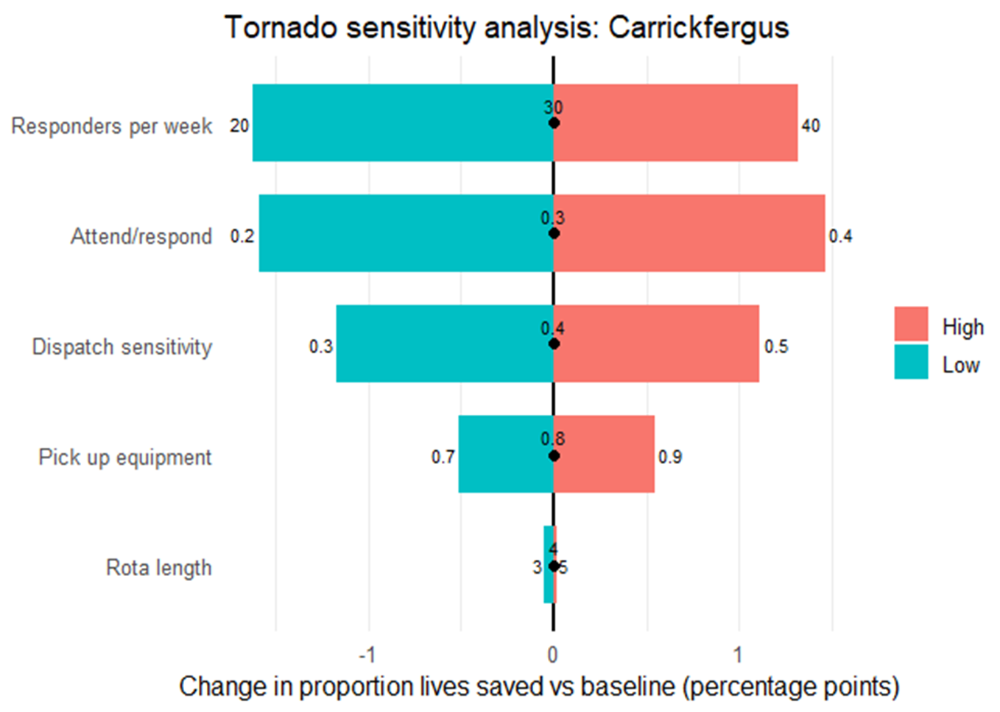

### Ambulance handover queues (discrete-event simulation)

The script is [`des/ambulance_handover_des.Rmd`](des/ambulance_handover_des.Rmd). It models Northern Ireland Ambulance Service calls in four priority categories, a pooled fleet and a pooled set of hospital handover bays. With five bays the mean handover takes 17.8 minutes against the 15-minute target, and call queues add almost nothing to response times. Removing one of the five bays raises the mean wait for a handover bay from 2.5 to 13.6 minutes and slows category 3 and 4 responses by about 3 minutes at the median, while category 1 and 2 barely change.

The figures below are from the dissertation (Chapter 5).

**Demand and fleet.** Expected incidents each hour (orange) against the ambulance fleet available (grey). The demand curve follows the weekly pattern in the NHS England time-of-day data.

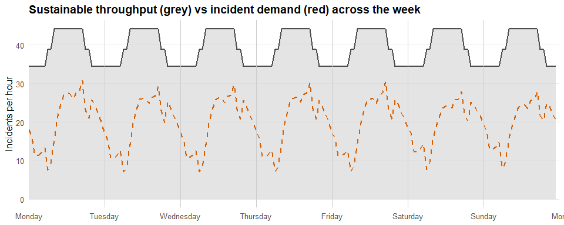

**Handover queues build through the day.** The mean number of ambulances waiting for a handover bay is close to zero overnight, starts rising late morning and peaks in the early evening.

<p>
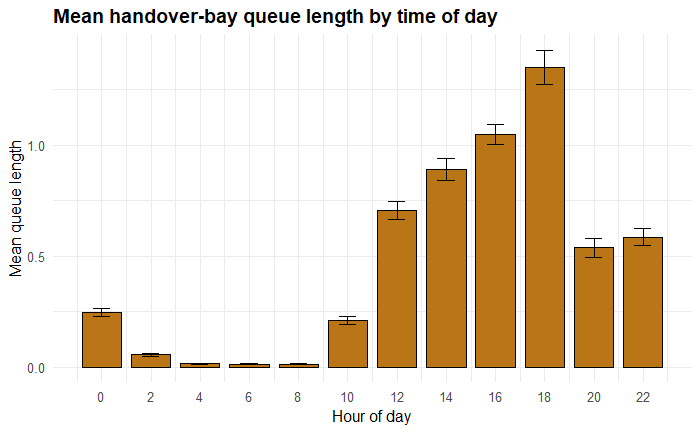
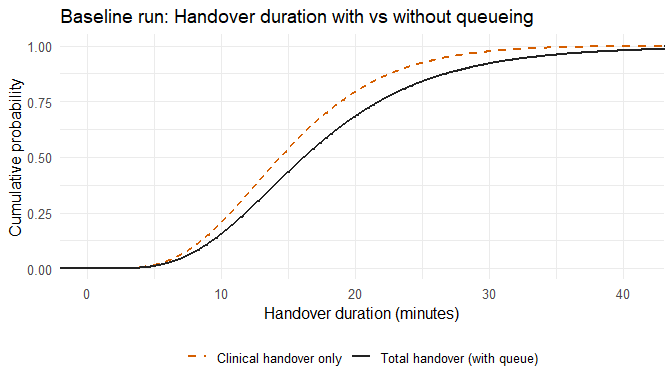
</p>

In the baseline the queue for a bay adds about 1.8 minutes to the median handover and 4.6 minutes at the 90th percentile.

**Taking one bay away.** The handover time distribution with four bays, then the effect on the mean wait for a bay in the one-way sensitivity analysis (orange is 10% lower or one bay fewer, green is 10% higher or one more).

<p>
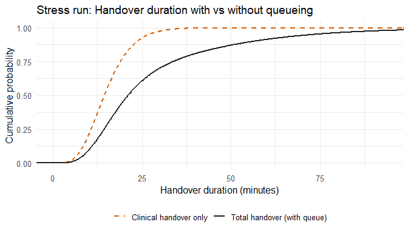
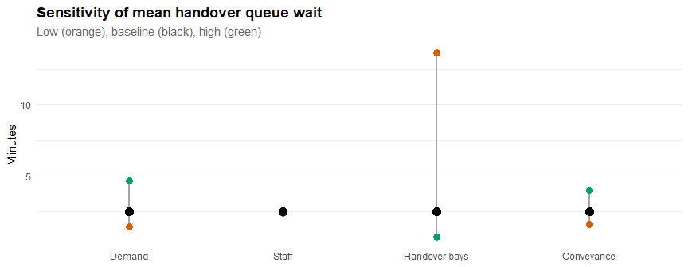
</p>

**Effect on response times.** Response time distributions by call category with five bays (black) and four bays (orange). Categories 1 and 2 hardly move; categories 3 and 4 shift later.

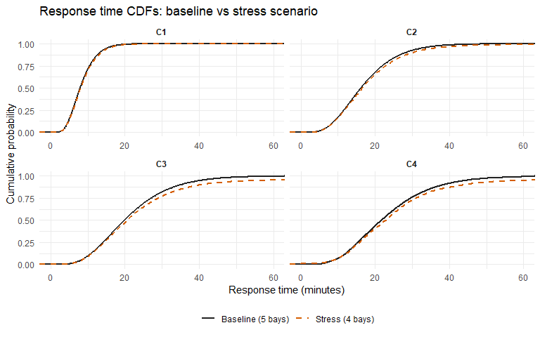

## Things to keep in mind when reading the results

- **Too many arrests.** Arrest rates come from Belfast data collected in 1985 to 1987. The model gives 2,627 witnessed ventricular fibrillation arrests a year (138 per 100,000). The published Northern Ireland figures it was compared with, roughly 1,400 to 1,500 a year, count every cardiac arrest where resuscitation is attempted, so the model's count of one type of arrest is already above their total. If the true number is lower, there would be fewer extra survivors and the cost per QALY would be higher.
- **Old costs.** Costs come from published figures from around 2006 and have not been adjusted for inflation (the Bank of England estimates +75.1% from 2006 to 2026), which would make the scheme look worse.
- **Fixed scheme cost.** The scheme costs £474,256 per district over five years however many volunteers there are, so the results for different numbers of volunteers show the benefit but not any extra cost of recruiting more.
- **Unstable ratios.** The cost per QALY is a ratio, and with few survivors it swings widely. The mean of the five-year ratios is pulled up by periods with very few survivors, hence the wide ranges for Carrickfergus and Fermanagh.
- **Borrowed long-term survival.** Long-term survival is matched to Swedish data (Dillenbeck et al.), which assumes the neurological categories map onto their categories and that hazards are proportional.
- **Threshold.** £30,000 and £35,000 are the upper ends of NICE's old and new ranges, which apply to medicines. Whether they would apply to a scheme like this has not been decided.
- **Simple queueing model.** The discrete-event model pools hospitals and ambulances and uses several assumed times. It is not linked to the volunteer model.

## Run the code

You need R 4.x and the five input files described in [`data/README.md`](data/README.md), placed in `data/raw/`. Packages install themselves on the first run.

```r
# from the project folder, in an R session
Sys.setenv(N_SIM_YEARS = 20)   # quick check with 20 simulated years instead of 1,000
source("run_all.R")
```

Leave out the first line for the full run (1,000 simulated years, as in the dissertation). File locations and the number of simulated years are set in `config.R`.

| Script | What it does |
|---|---|
| `scripts/01_station_distances.R` | Geocodes the ambulance stations, finds the nearest and second-nearest to each Data Zone centroid and writes `data/processed/coa_nearest_ambulance.csv`. Needs internet, and is skipped if the file already exists |
| `scripts/02_simulate_arrests.R` | Reads and merges the inputs, calculates expected arrests, simulates arrests and their ambulance times |
| `scripts/03_inputs_and_allocation.R` | Life tables, costs and utilities, the twelve allocation rules, volunteer home locations |
| `scripts/04_model_functions.R` | The model itself: paging and response, Markov microsimulation, five-year blocks, `run_rule_lgd()` |
| `scripts/05_screening_allocation_rules.R` | Screens all twelve rules in all districts and writes the rule tables to `outputs/tables/` |
| `scripts/06_cost_effectiveness.R` | The 1,000-year runs, cost-effectiveness planes and acceptability curves, and the Belfast case study |
| `scripts/07_maps_and_plots.R` | District summaries and maps |

Plots are drawn on screen (the Plots pane in RStudio). The cost per QALY figures quoted above come from the five-year blocks (`summarise_5yr()` in script 06). The `mean_icer` column returned by `run_rule_lgd()` is a per-year figure that puts the whole five-year scheme cost on every year, so it is much higher and should not be quoted.

Not in this folder yet: the sensitivity (tornado) code, the code for the volunteer-count sweep and the validation summaries.

### Running the discrete-event simulation

The full run takes hours: 50 baseline replications, 12 sensitivity scenarios of 8 replications each and 10 stress replications, each replication simulating 60 days after a 14-day warm-up. The script saves each result in `des/saved/` and reads it back on later knits, so it only runs once. To check that the code works without waiting, set `DES_QUICK=1` first, which runs 3, 2 and 2 replications and saves them in `des/saved_quick/`. `DES_RERUN=1` ignores saved results and runs everything again.

```r
Sys.setenv(DES_QUICK = 1)
rmarkdown::render("des/ambulance_handover_des.Rmd")
```

The quick run gives rough numbers, so use it for checking only. It needs the NHS England time-of-day ambulance attendance workbook in `data/raw/` (see `data/README.md`).

## What is in this folder

```
README.md        this page
CHANGES.md       what I changed when tidying the original code
config.R         file locations and number of simulated years
run_all.R        runs the scripts in order
scripts/         the numbered R scripts for the volunteer model
des/             the discrete-event simulation of ambulance handover queues
data/            where the input files go (see data/README.md)
figures/         figures from the dissertation used on this page
report/          the dissertation (PDF)
original/        my R Markdown files exactly as submitted with the dissertation
```

The input data files are not included (see `data/README.md`).

## References

- Cairns KJ, Marshall AH, Kee F (2011). Using simulation to assess cardiac first-responder schemes exhibiting stochastic and spatial complexities. *Journal of the Operational Research Society* 62(6):982-991.
- Valenzuela TD, Roe DJ, Cretin S, Spaite DW, Larsen MP (1997). Estimating effectiveness of cardiac arrest interventions: a logistic regression survival model. *Circulation* 96(10):3308-3313.
- Dillenbeck E, et al. (2024). Neurologic recovery at discharge and long-term survival after cardiac arrest. *JAMA Network Open* 7:e2439196.
- Moore MJ, Hamilton AJ, Cairns KJ, et al. (2008). The Northern Ireland Public Access Defibrillation (NI-PAD) study: effectiveness in urban and rural populations. *Heart* 94(12):1614-1619.
- Pell JP, Corstorphine M, McConnachie A, et al. (2006). Post-discharge survival following pre-hospital cardiopulmonary arrest due to cardiac aetiology: temporal trends and impact of changes in clinical management. *European Heart Journal* 27(4):406-412.
